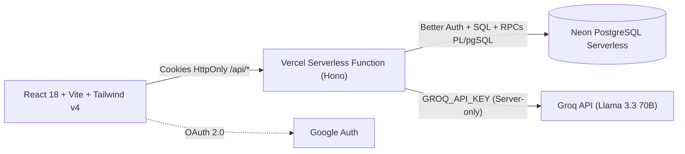

# 🎓 OmniLearn — Educação Eficiente com IA


[](./LICENSE)

> **OmniLearn (Educação Eficiente)** é uma plataforma web de aprendizagem gamificada e assistida por Inteligência Artificial que transforma PDFs, slides (PPTX) e anotações em sessões adaptativas de 15 minutos por dia, flashcards com repetição espaçada (Leitner) e resumos gerados sob demanda.

🔗 **Aplicação em Produção (Live Demo):** [https://educacao-eficiente.vercel.app/](https://educacao-eficiente.vercel.app/)

---

## ✨ Funcionalidades Principais

- 📄 **Extração Local no Navegador (Privacidade by Design):** PDFs (até 30 págs) e PPTX (até 40 slides) têm o texto extraído direto no cliente via `pdfjs-dist` e `jszip` carregados sob demanda (*lazy-load*), sem armazenar arquivos binários brutos na nuvem.
- 🧠 **Geração Adaptativa com IA (Groq / Llama 3.3 70B):** cria 5 formatos de questão (múltipla escolha, verdadeiro/falso, preenchimento, associação e resposta curta com tolerância a erros de digitação via distância de Levenshtein), além de resumos e explicações alternativas.
- 🎮 **Gamificação & Revisão Espaçada:** sessões adaptativas (modos inteligente, revisão, tópico e prova), sistema de caixas de **Leitner (1–5)** em Flashcards, ofensiva diária (*streak*), XP, níveis, conquistas e impressão com gabarito.
- 🔐 **Autenticação & Conformidade LGPD:** login por e-mail/senha e Google OAuth via **Better Auth** com cookies `HttpOnly`, *consent gate* versionado para todos os fluxos de entrada, filtro preventivo de dados sensíveis (CPF/cartão), exportação dos dados em JSON (Art. 18, II e V) e exclusão definitiva em cascata (Art. 18, VI).
- 🌐 **Bilíngue & Acessível:** interface completa em Português (PT-BR) e Inglês (EN), tema claro/escuro e cabeçalhos de segurança rígidos (`CSP`, `HSTS`, `X-Frame-Options`).

---

## 🛠️ Arquitetura & Stack Tecnológica



- **Frontend:** React 18, TypeScript (strict), Vite 5, Tailwind CSS v4, React Router v6, Lucide Icons, DOMPurify.
- **Backend Serverless:** **Hono** em um único entrypoint na Vercel (`api/index.ts`), rodando localmente em paralelo ao Vite.
- **Autenticação:** **Better Auth** (e-mail/senha + Google OAuth) com sessão via cookie `HttpOnly` persistida no PostgreSQL.
- **Banco de Dados:** **Neon PostgreSQL Serverless** com funções PL/pgSQL atômicas (`start_session`, `record_answer`, `complete_session`, `review_flashcard`) e *scale-to-zero* sem pausas manuais por inatividade.
- **Inteligência Artificial:** **Groq API** (`openai/gpt-oss-120b`) executada exclusivamente no servidor, com controle de cota diária por usuário e suporte opcional à **NVIDIA NIM** para PDFs grandes.

---

## 🚀 Como Executar Localmente

### Pré-requisitos
- [Node.js 20+](https://nodejs.org/)
- Banco gratuito no [Neon](https://console.neon.tech/)
- Chave da [Groq Cloud](https://console.groq.com/)
- *(Opcional para login Google)* Credenciais OAuth 2.0 no [Google Cloud Console](https://console.cloud.google.com/apis/credentials)

### 1. Clonar o repositório e instalar dependências

```bash
git clone https://github.com/LucasLibonatti/OmniLearn.git
cd OmniLearn
npm install
```

### 2. Criar o banco no Neon

Abra o **SQL Editor** do seu projeto no [Neon Console](https://console.neon.tech/), cole o conteúdo de [`db/schema.sql`](./db/schema.sql) e execute (o script é idempotente e já popula o catálogo de conquistas e as 4 funções PL/pgSQL).

### 3. Configurar as Variáveis de Ambiente

Copie `.env.example` para `.env`:

```bash
cp .env.example .env
```

> **Segurança:** nenhuma chave sensível usa prefixo `VITE_`. Todas as credenciais abaixo rodam **exclusivamente no servidor** (Vercel Functions / API local).

| Variável | Obrigatória | Finalidade |
| :--- | :---: | :--- |
| `DATABASE_URL` | Sim | Connection string *pooled* do Neon PostgreSQL (`?sslmode=require`) |
| `BETTER_AUTH_SECRET` | Sim | Segredo aleatório (32+ caracteres) para assinar sessões do Better Auth |
| `BETTER_AUTH_URL` | Sim | URL base do app (`http://localhost:5173` em dev / URL da Vercel em produção) |
| `GROQ_API_KEY` | Sim | Chave da Groq API para geração de questões, resumos e explicações |
| `NVIDIA_API_KEY` / `NVIDIA_MODEL` | Opcional | NVIDIA NIM usada apenas para PDFs grandes (acima de `LARGE_PDF_CHARS`, padrão 60.000 caracteres), com a Groq como reserva |
| `GOOGLE_CLIENT_ID` / `GOOGLE_CLIENT_SECRET` | Opcional | Habilita "Continuar com Google" (callback: `<BETTER_AUTH_URL>/api/auth/callback/google`) |

### 4. Iniciar em desenvolvimento

```bash
npm run dev
```

Isso inicia simultaneamente a **API Hono** (`http://localhost:3001`) e o **frontend Vite** (`http://localhost:5173`, com proxy automático de `/api`).

### Scripts Disponíveis

| Comando | Descrição |
| :--- | :--- |
| `npm run dev` | Inicia API local (`tsx watch`) + Vite HMR em paralelo |
| `npm test` | Executa a suíte de testes unitários com **Vitest** (`answerMatch`, `piiCheck`, `dates`, `xp`) |
| `npm run build` | Valida TypeScript (frontend + servidor) e gera o build de produção em `dist/` |
| `npm run preview` | Executa localmente o build de produção para validação |

---

## 📂 Estrutura do Projeto

```text
OmniLearn/
├── .github/workflows/       # CI automatizado (Vitest + Typecheck + Vite build)
├── api/                     # Entrypoint serverless da Vercel (Hono)
├── db/
│   └── schema.sql           # Schema consolidado PostgreSQL (Neon + Better Auth + RPCs)
├── Icons/                   # Mascote Prof. Omni e ícones 3D otimizados em WebP
├── public/                  # Favicon e ativos estáticos
├── server/
│   ├── app.ts               # Aplicação Hono e registro de rotas /api/*
│   ├── auth.ts              # Configuração Better Auth (E-mail + Google OAuth)
│   ├── db.ts                # Pool PostgreSQL (Neon) e helpers de data SP
│   ├── dev.ts               # Servidor Node local para desenvolvimento
│   └── routes/              # profile, subjects, sessions, study, ai e account (LGPD)
├── src/
│   ├── __tests__/           # Testes unitários (Vitest): answerMatch, piiCheck, dates, xp
│   ├── components/          # Layout, ErrorBoundary, Toast, SubjectCard, WeekStrip, ConsentGate
│   ├── context/             # AppDataContext (cache global sincronizado de Perfil e Matérias)
│   ├── engine/              # Motor adaptativo e cálculo de XP/nível
│   ├── hooks/               # useApp, useAsync, useSettings
│   ├── lib/                 # api.ts, extract.ts (lazy PDF/PPTX), piiCheck.ts, answerMatch.ts
│   ├── locales/             # Traduções EN (en-core.ts, en-pages.ts)
│   ├── pages/               # Telas internas modularizadas com code-splitting por rota
│   ├── services/            # Camada de comunicação com /api/*
│   ├── App.tsx              # Rotas e lazy-loading por página
│   ├── AuthPage.tsx         # Tela de login e cadastro
│   ├── Session.tsx          # Executor de sessões e modo prova
│   └── pages_*.tsx          # Landing interativa, suporte e diretrizes LGPD
├── .env.example             # Modelo de variáveis de ambiente
├── LICENSE                  # Licença MIT
├── vercel.json              # Rewrites SPA/API e headers de segurança (CSP/HSTS)
└── vite.config.ts           # Configuração Vite + proxy /api
```

---

## 📄 Licença

Distribuído sob a licença **MIT**. Consulte o arquivo [`LICENSE`](./LICENSE) para mais detalhes.

## 👨‍💻 Autor

Desenvolvido por **Lucas Alexander Libonatti**.

- 🐙 **GitHub:** [@LucasLibonatti](https://github.com/LucasLibonatti)
- 💼 **LinkedIn:** [Lucas Alexander Libonatti](https://linkedin.com/in/lucaslibonatti)
- 🌐 **Projeto Online:** [OmniLearn na Vercel](https://educacao-eficiente.vercel.app/)
